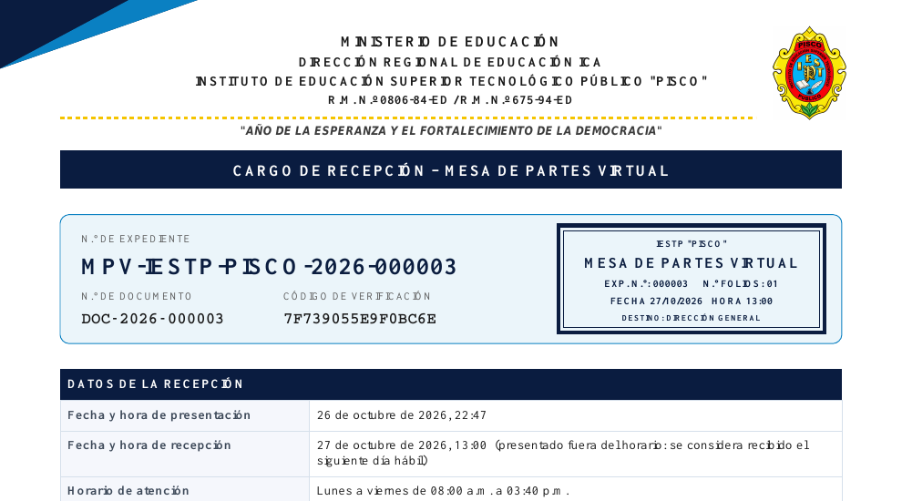
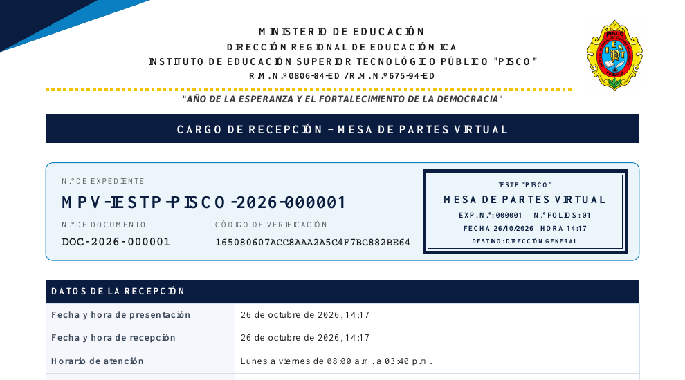

# Comprobación visual del cargo corregido

Ejemplos generados con datos sintéticos en la instalación local de pruebas. No corresponden a expedientes reales ni a documentos oficiales emitidos en Hostinger. Las fechas y la numeración pertenecen a esa instalación de pruebas.

## Nuevo código de 16 caracteres

[Descargar PDF de prueba de 16 caracteres](cargo-16-caracteres.pdf)

## Código anterior de 32 caracteres

[Descargar PDF de prueba de 32 caracteres](cargo-32-caracteres.pdf)

Se registró un expediente nuevo desde el formulario real y se generaron ambos PDF. Se verificó la descarga y la consulta por número/código para ambos expedientes. Se comprobó además la posición del texto extraído del PDF: separación al sello de 28,44 mm para el nuevo código y 4 mm para el código anterior. No se acortan los códigos existentes ni se invalidan sus QR.

El código de aplicación es idéntico al paquete de la rama `hostinger-cargo-corregido`. Estos ejemplos y pruebas se publican por separado: no es necesario subirlos al hosting.

La consulta a la página pública de Hostinger desde el entorno de pruebas fue bloqueada por la red (túnel HTTP 403); no se certifica qué archivos están instalados allí.

Para comprobar la subida, en hPanel el archivo `portal-private/Portal.php` debe contener `random_bytes(8)` en la generación de `cargoCod`, y `portal-private/views/portal.php` debe contener `verificationWidth` y `verificationSize`. Conserva config.php, limpia la caché y vuelve a descargar el cargo desde una ventana privada. Un PDF previamente guardado no se modifica solo.
