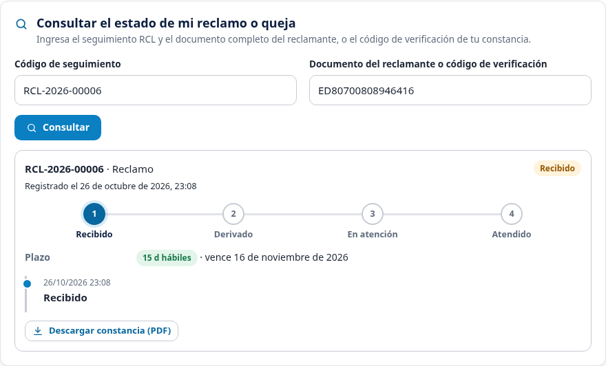
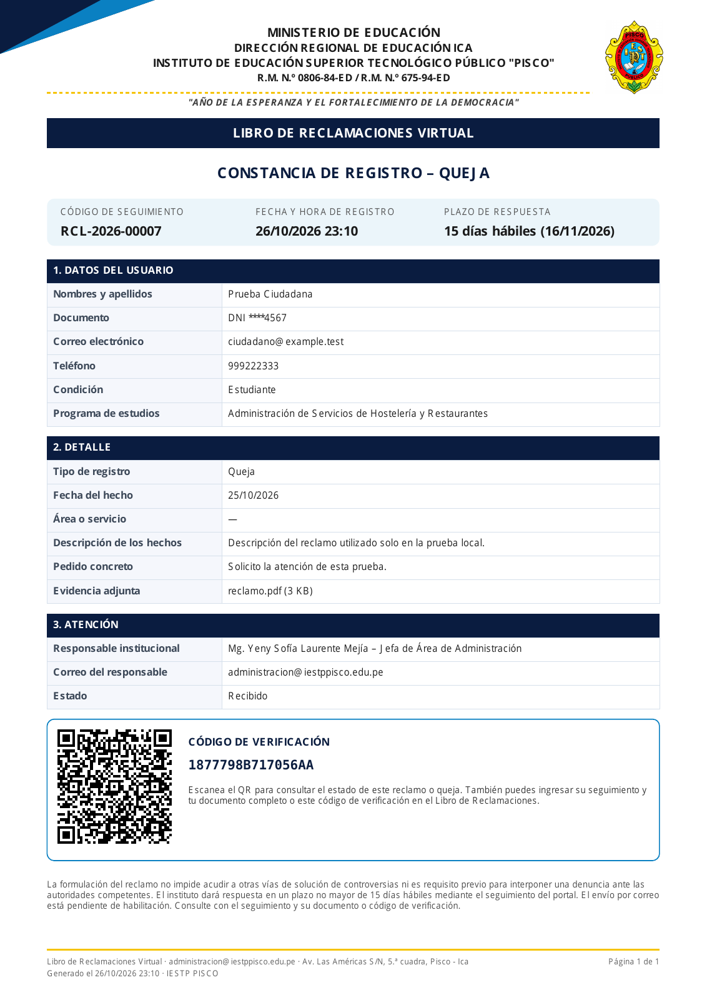

# Libro de Reclamaciones — pruebas con datos sintéticos

Ejemplos locales de prueba; no son expedientes reales del hosting ni documentos oficiales para presentar.

## Consulta abierta desde el QR del PDF

## Constancia de un reclamo

[Descargar PDF de reclamo](reclamo.pdf)

## Constancia de una queja

[Descargar PDF de queja](queja.pdf) · [PDF de un reclamo anterior actualizado](reclamo-anterior.pdf)

Los QR de los PDF fueron decodificados con zxing-cpp. El enlace leído del PDF se abrió desde una sesión nueva y mostró el seguimiento correcto. Los ejemplos enlazan a localhost porque pertenecen a la instalación local de pruebas; en Hostinger la constancia utiliza el dominio desde el que se emite.

Pruebas reproducibles: tests/claims-verification.php y tests/browser-claims-verification.cjs. El segundo se ejecutó también con CLAIM_TYPE=Queja. Las herramientas de prueba y estas evidencias no deben subirse al hosting.
